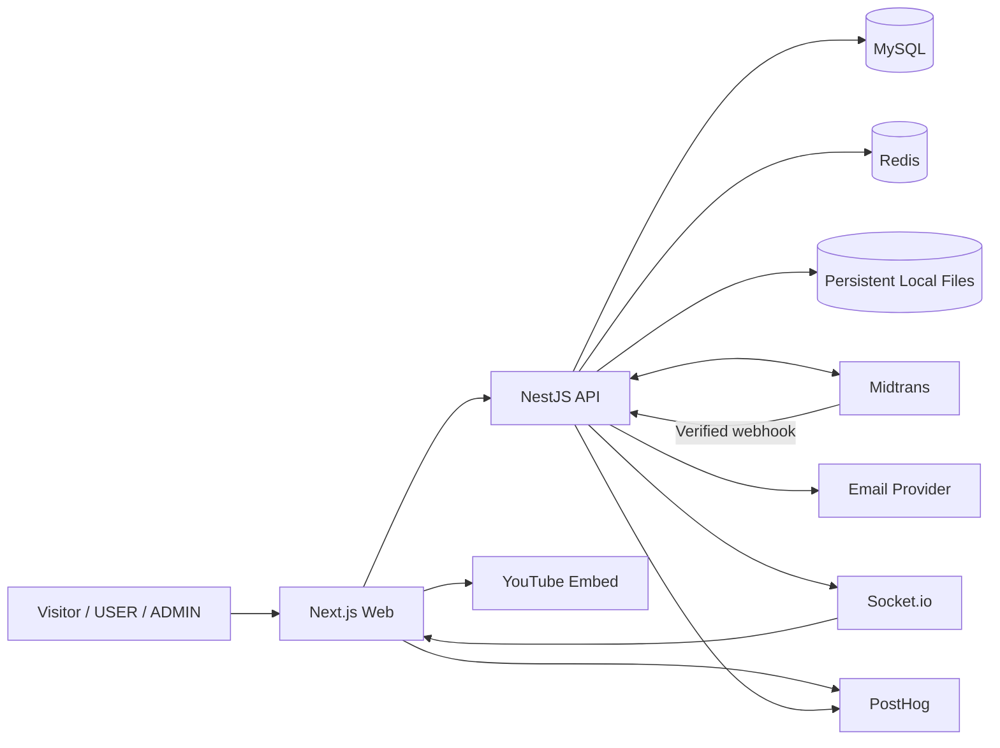

# System Architecture

## Goals

Separate UI, business logic, persistence, marketing content, and external integrations; protect payments and user data; support a single-product deployment on VPS/Coolify; remain maintainable without unnecessary distributed-system complexity.

## Context

## Applications

- `apps/web`: Next.js App Router frontend. Handles public pages, learner area, admin UI, API client, i18n, and marketing content rendering.
- `apps/api`: NestJS REST API on Node.js 24 LTS. Owns domain logic, authorization, persistence, payment adapters, uploads, notifications, and analytics/report queries.
- `apps/docs`: Fumadocs documentation app.
- `packages/db`: TypeORM data source, entities, and migrations.
- `packages/env`: runtime environment validation.
- `packages/config`: shared TypeScript and tooling configuration.

Marketing content is local typed content in `apps/web`. It is not the source of truth for courses, users, orders, payments, enrollments, progress, projects, or certificates.

## Backend domains

Auth, Users, Courses, Catalog, Orders, Payments, Refunds, Enrollments, LearningProgress, Quizzes, Roadmaps, Projects, Certificates, Community, Reviews, Wishlist, Coupons, Notifications, Uploads, Admin, Analytics, Audit, Health. Each module owns its domain logic; cross-module access goes through services/use cases, not arbitrary repository access.

## Request flow

Browser → Next.js → NestJS validation/auth/authorization → domain service → TypeORM/MySQL or integration adapter → DTO response. Do not expose TypeORM entities directly.

API conventions:

- Base path `/api/v1`.
- Success envelope `{ "data": {}, "meta": {} }`.
- Error envelope RFC 9457 Problem Details (`application/problem+json`) with `type`, `title`, `status`, `detail`, `instance`, `code`, `requestId`, and optional `errors`.
- Stable application error codes.
- ISO 8601 UTC timestamps.
- IDR integer money.
- Cursor or page pagination consistently applied.

## Payment

Create order and expected amount server-side; apply at most one coupon; request payment through the provider adapter (Midtrans initially); verify Midtrans notification/webhook using the current official signature/verification contract; deduplicate event; reconcile amount/currency/reference; atomically mark paid and create enrollment. Reconcile missed events safely. Never fulfill from browser redirect alone. Full refunds only; revocation follows provider-confirmed success.

## Authentication

JWT access/refresh in Secure HttpOnly cookies in production; rotate refresh token and persist hashed session in MySQL; revoke on logout; enforce role and ownership on API. Configure SameSite and CSRF/origin protections for cookie-authenticated mutations. Redis is not the refresh-session source of truth.

## Redis

Redis supports:

- Cache for public catalog/roadmap data with short TTLs.
- Rate limiting for auth, payment, webhook, upload, and community endpoints.
- Optional short-lived coordination locks.

Orders, payments, enrollments, progress, projects, and certificates remain authoritative in MySQL. Redis loss must not corrupt business state.

## Realtime notifications

Socket.io delivers in-app notifications for payment, review, certificate, and community events. The client falls back to polling when the socket is unavailable. Socket authentication uses the same session identity as REST; never trust client-supplied user IDs.

## Analytics and feature flags

PostHog handles product analytics events and feature flags. Do not send secrets, tokens, cookies, payment data, or unnecessary personal data. Admin financial and learning reports are computed from MySQL, not PostHog.

## Files

Local persistent VPS volume; outside public/executable root; opaque generated storage keys; metadata in MySQL; validate size/MIME/extension; serve through authorized route; back up files and database. Multi-instance scaling requires shared storage or migration to object storage.

## Reliability/security

Use transactions for multi-record changes; unique constraints for webhook IDs, provider references, enrollments, active certificates, and coupon redemptions; idempotent operations; transactional outbox for email notifications; bounded retry. HTTPS, rate limits, strict CORS, safe rich-text sanitization, upload validation, ORM parameterization, audit logs, and secret redaction.

## Observability

Structured logs with request ID, health/readiness checks, error monitoring, payment/webhook metrics, Redis health, disk and backup monitoring. Never log passwords, tokens, cookies, payment secrets, or unnecessary personal data.
