# Entity Relationship Diagram

Conceptual baseline; exact columns, nullability, indexes, and migrations are finalized in implementation and must align with `database-design.md`.

```mermaid
erDiagram
 USERS ||--o{ ORDERS : places
 USERS ||--o{ REFRESH_SESSIONS : owns
 USERS ||--o{ ENROLLMENTS : receives
 USERS ||--o{ LESSON_PROGRESS : tracks
 USERS ||--o{ QUIZ_ATTEMPTS : takes
 USERS ||--o{ PROJECT_SUBMISSIONS : submits
 USERS ||--o{ CERTIFICATES : earns
 USERS ||--o{ DISCUSSION_TOPICS : creates
 USERS ||--o{ LESSON_QUESTIONS : asks
 USERS ||--o{ NOTIFICATIONS : receives
 USERS ||--o{ WISHLISTS : saves
 USERS ||--o{ COURSE_REVIEWS : writes
 USERS ||--o{ CONTENT_REPORTS : reports
 USERS ||--o{ AUDIT_LOGS : performs

 ORDERS ||--|{ ORDER_ITEMS : contains
 ORDERS ||--o{ PAYMENTS : has
 ORDERS ||--o{ REFUND_REQUESTS : may_have
 COURSES ||--o{ ORDER_ITEMS : purchased_as
 COURSES ||--o{ ENROLLMENTS : grants
 COURSES ||--o{ COURSE_SECTIONS : contains
 COURSES ||--o{ COURSE_CATEGORIES : classified_by
 CATEGORIES ||--o{ COURSE_CATEGORIES : groups
 COURSE_SECTIONS ||--o{ LESSONS : contains
 COURSES ||--o{ QUIZZES : configures
 LESSONS ||--o{ QUIZZES : may_own
 COURSE_SECTIONS ||--o{ QUIZZES : may_own
 QUIZZES ||--o{ QUIZ_QUESTIONS : contains
 QUIZ_QUESTIONS ||--o{ QUIZ_OPTIONS : offers
 QUIZZES ||--o{ QUIZ_ATTEMPTS : records
 QUIZ_ATTEMPTS ||--o{ QUIZ_ANSWERS : contains
 LESSONS ||--o{ LESSON_PROGRESS : has

 ROADMAPS ||--o{ ROADMAP_COURSES : orders
 COURSES ||--o{ ROADMAP_COURSES : appears_in
 COURSES ||--o| FINAL_PROJECTS : defines
 FINAL_PROJECTS ||--o{ PROJECT_RUBRIC_CRITERIA : scores_with
 FINAL_PROJECTS ||--o{ PROJECT_SUBMISSIONS : receives
 PROJECT_SUBMISSIONS ||--o{ SUBMISSION_FILES : attaches
 PROJECT_SUBMISSIONS ||--o{ SUBMISSION_SCORES : receives
 PROJECT_RUBRIC_CRITERIA ||--o{ SUBMISSION_SCORES : used_in

 ENROLLMENTS ||--o{ CERTIFICATES : qualifies_for
 COURSES ||--o{ CERTIFICATES : certifies
 CERTIFICATES ||--o| CERTIFICATES : reissued_as
 ENROLLMENTS ||--o| COURSE_REVIEWS : reviewed_by

 DISCUSSION_TOPICS ||--o{ DISCUSSION_REPLIES : has
 LESSONS ||--o{ LESSON_QUESTIONS : contextualizes
 LESSON_QUESTIONS ||--o{ LESSON_ANSWERS : has
 CONTENT_REPORTS }o--|| DISCUSSION_TOPICS : may_target
 CONTENT_REPORTS }o--|| DISCUSSION_REPLIES : may_target

 COUPONS ||--o{ COUPON_REDEMPTIONS : redeemed_as
 ORDERS ||--o{ COUPON_REDEMPTIONS : applies
 USERS ||--o{ COUPON_REDEMPTIONS : uses
 NOTIFICATION_OUTBOX }o--|| USERS : addressed_to
 PLATFORM_SETTINGS }o--|| USERS : updated_by
 ANNOUNCEMENTS }o--|| USERS : authored_by
```

## Modeling notes

- Initial checkout is one course per order; `order_items` preserves extensibility without enabling bundle sales.
- Enrollment is a separate entitlement record with source `PURCHASE`, `FREE`, or `ADMIN_GRANT`.
- Payment webhook events are deduplicated and retained.
- Each project resubmission is a new immutable version.
- Roadmap membership never creates enrollment. Progression is always sequential.
- Course completion requires required lessons, required quizzes, and project approval only when the final project is enabled.
- Certificate issuance is unique/idempotent; one active certificate per enrollment. Revocation keeps the old record; reissue creates a new record linked by `reissued_from_certificate_id`.
- Reviews are one per enrollment and remain `PENDING` until ADMIN publishes them.
- Wishlist entries are unique per user/course.
- Coupon redemptions record the order and cannot exceed configured limits. One coupon per order.
- Community content tracks author, context, moderation state, reports, and timestamps.
- Financial, submission, certificate, and audit history must not be cascade-deleted.
